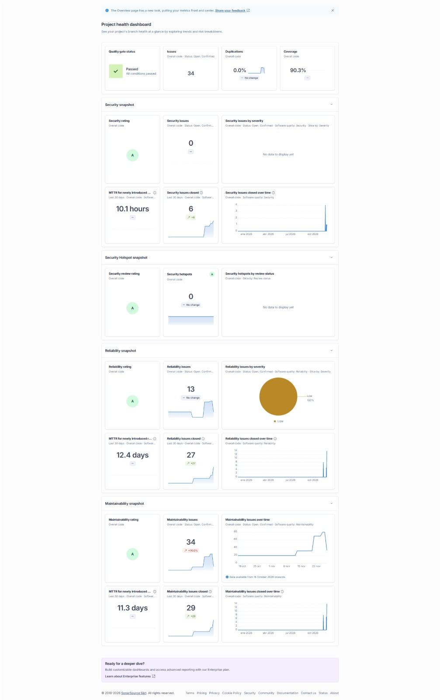
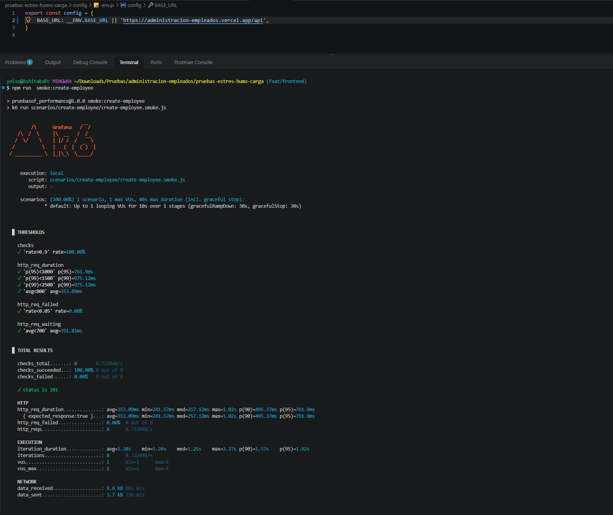
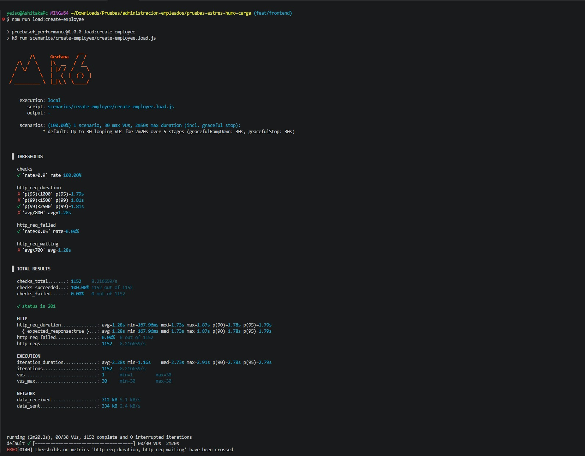
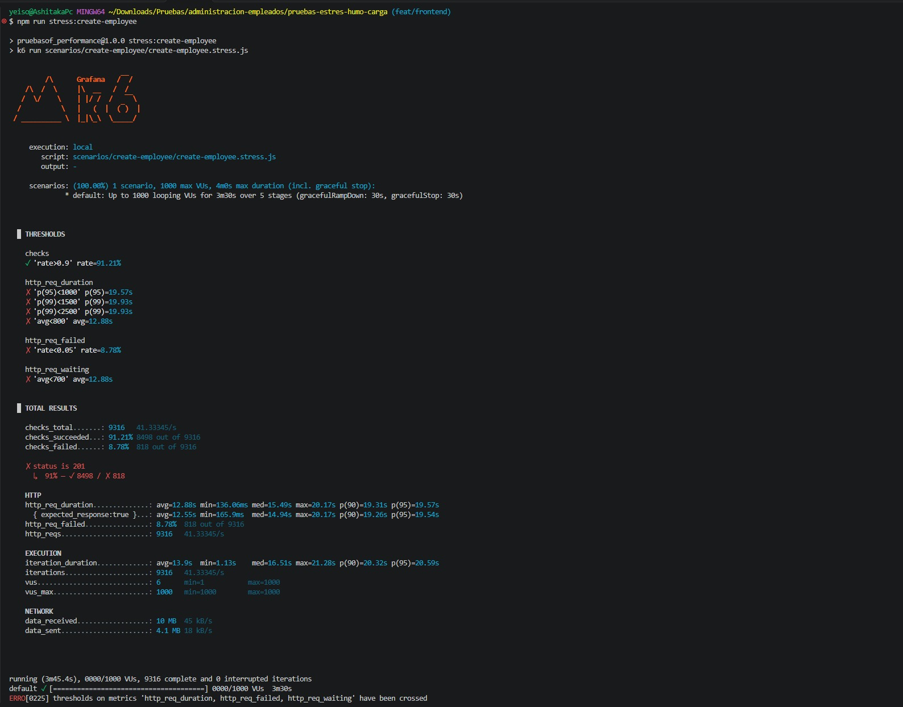

# Administración de empleados

[](https://github.com/LauraArias56/administracion-empleados/actions/workflows/ci.yml)

Aplicación web para gestionar empleados, contratos, vacaciones e historial laboral. La interfaz usa React y Vite. La API REST usa Express, TypeScript y Awilix, con PostgreSQL en Supabase para la persistencia.

## Enlaces

| Recurso | Enlace |
| --- | --- |
| Repositorio | [LauraArias56/administracion-empleados](https://github.com/LauraArias56/administracion-empleados) |
| Aplicación web | [Administración de empleados en Vercel](https://administracion-empleados.vercel.app/) |
| Pipeline de CI | [Ejecuciones en GitHub Actions](https://github.com/LauraArias56/administracion-empleados/actions/workflows/ci.yml) |

## Pipeline de integración continua

El [workflow de CI](.github/workflows/ci.yml) se ejecuta con Node.js 22 en Ubuntu al abrir, actualizar o reabrir un pull request, y al subir cambios a `main`, `master` o `fix/sonar-duplication-cleanup`. Instala las dependencias de la API y del frontend, compila ambos, ejecuta las pruebas unitarias con cobertura, valida los tipos de las pruebas de API y ejecuta Playwright contra un PostgreSQL temporal del runner.

### SonarCloud

GitHub Actions ejecuta el análisis con los valores de `sonar.projectKey` y `sonar.organization` definidos en [sonar-project.properties](sonar-project.properties) y el secreto `SONAR_TOKEN` del repositorio. [Panel del proyecto en SonarCloud](https://sonarcloud.io/project/overview?id=LauraArias56_administracion-empleados).

El análisis incluye la API y el frontend. La cobertura corresponde a las pruebas unitarias de la API y se importa desde `coverage/lcov.info`.



Resumen del análisis de `main` del 27 de noviembre de 2026.

| **Métrica**       | **Resultado**                        |
| ----------------- | ------------------------------------ |
| Seguridad         | A · 0 issues abiertos o confirmados  |
| Fiabilidad        | A · 13 issues abiertos o confirmados |
| Mantenibilidad    | A · 34 issues abiertos o confirmados |
| Issues aceptados  | 0                                    |
| Cobertura         | 90,3 % (363 líneas medibles)         |
| Duplicaciones     | 0,0 % (2.398 líneas de código)       |
| Security hotspots | 0                                    |

## Requisitos

- **Node.js 22.13 o superior** y npm.
- Una base PostgreSQL. Para desarrollo con Supabase, usa la URL de conexión de tu proyecto.

## Instalación y ejecución local

Clona el repositorio e instala las dependencias desde la raíz del proyecto.

```bash
git clone https://github.com/LauraArias56/administracion-empleados.git
cd administracion-empleados
npm ci
npm ci --prefix frontend
```

Configura `DATABASE_URL` en un archivo local `.env` con el formato de [.env.example](.env.example). En Vercel, configura esta variable en el entorno de producción.

Inicia la API en una terminal y la interfaz en otra, ambas desde la raíz.

| Componente | Comando | URL local |
| --- | --- | --- |
| API | `npm run dev` | `http://localhost:3000/api/v1` |
| Interfaz web | `npm run dev --prefix frontend` | `http://localhost:5173` |

Para ejecutar la versión compilada de la API, usa `npm run build` seguido de `npm start`.

## Comandos

| Comando | Qué hace |
| --- | --- |
| `npm run build` | Compila la API a `dist/` y el frontend a `frontend/dist/` |
| `npm start` | Inicia la API (`dist/main.js`) en `http://localhost:3000`. Ejecutar antes `npm run build` |
| `npm run dev` | Inicia la API en modo desarrollo (`tsx watch`) |
| `npm test` | Pruebas unitarias (Vitest) |
| `npm run test:coverage` | Ejecuta Vitest y genera los informes `coverage/index.html` y `coverage/lcov.info` |
| `npm run test:api` | Compila y ejecuta las pruebas de API con Playwright contra la app real y PostgreSQL en `test_api` |
| `npm run test:api:report` | Abre el reporte HTML de la última ejecución de Playwright |
| `npm run check:endpoints` | Verifica que cada endpoint de la app tiene pruebas Playwright |
| `npm run verify:persistence` | Arranca la app, crea datos, la reinicia y comprueba que los datos siguen |
| `npm run typecheck:api` | Comprueba los tipos de las pruebas Playwright |

## Endpoints

La URL base de la API local es `http://localhost:3000/api/v1`. El frontend usa las mismas rutas con el prefijo `/datos/v1`.

| Método | Ruta | Descripción |
| --- | --- | --- |
| GET | `/employees` | Lista los empleados |
| POST | `/employees` | Crea un empleado con cargo, salario, estado y contrato |
| GET | `/employees/:id` | Consulta el empleado, su contrato y el historial |
| PATCH | `/employees/:id` | Actualiza el cargo, el salario, el estado laboral o el estado del contrato. Registra en el historial los cambios de cargo, salario y estado laboral |
| POST | `/employees/:id/vacations` | Solicita vacaciones y valida fechas y solapes |
| GET | `/vacations` | Lista las solicitudes de vacaciones |
| PATCH | `/vacations/:id` | Aprueba o rechaza una solicitud pendiente |

Los cuerpos de las solicitudes y respuestas están definidos en [employee.dto.ts](src/dto/employee.dto.ts).

## Persistencia (PostgreSQL)

La API crea las tablas con `CREATE TABLE IF NOT EXISTS`. Los datos de SQLite anteriores requieren una importación aparte.

| Variable | Por defecto | Uso |
| --- | --- | --- |
| `DATABASE_URL` | — | URI PostgreSQL de Supabase; obligatoria |
| `DB_SCHEMA` | `public` | Esquema PostgreSQL |
| `PORT` | `3000` | Puerto de la API |
| `CORS_ORIGIN` | `http://localhost:5173` | Origen permitido para el cliente web |

### Tablas

Derivadas de lo que ya usaba la aplicación (`EmployeeRecord`, `HistoryEntryDTO`, `VacationRecord`):

| Tabla | Columnas | Restricciones |
| --- | --- | --- |
| `employees` | `id` BIGINT identity PRIMARY KEY, `document`, `first_name`, `last_name`, `position`, `salary` DOUBLE PRECISION, `status`, `contract_start_date` TEXT, `contract_type`, `contract_status` | `document` UNIQUE; `salary >= 0`; CHECK de `status`, `contract_type`, `contract_status` con los valores del DTO |
| `employee_history` | `id` BIGINT identity PRIMARY KEY, `employee_id` (FK → `employees.id`), `type`, `previous_value`, `new_value`, `changed_at` | CHECK de `type` (`cargo`, `salario`, `estado`); índice por `employee_id` |
| `vacations` | `id` BIGINT identity PRIMARY KEY, `employee_id` (FK → `employees.id`), `start_date`, `end_date` TEXT, `status` | CHECK de `status`; `end_date >= start_date`; índice por `employee_id` |

## Pruebas

- **Vitest**. Cubre el servicio, el controlador y el middleware de errores. Con `TEST_DATABASE_URL` apuntando a un PostgreSQL de pruebas, también valida los repositorios en esquemas temporales e incluye su cobertura en `coverage/lcov.info`. En CI se usa el PostgreSQL temporal del runner.
- **API (Playwright)**. `npm run test:api` usa `DATABASE_URL` para levantar la aplicación compilada en el puerto `3100` y recrear el esquema de pruebas `test_api`. Las pruebas hacen solicitudes HTTP y pueden ejecutarse sin instalar navegadores.
- **Rendimiento (k6)**. Las pruebas de estrés, humo y carga se ejecutan por separado del CI y se mantienen en el repositorio [YeisonCv/Pruebas_Estres_Humo_Carga](https://github.com/YeisonCv/Pruebas_Estres_Humo_Carga).

Para probar un entorno de integración remoto, establece `TEST_API_BASE_URL` con su URL base hasta `/api/`. Esta opción se usa fuera del CI y las pruebas crean empleados y solicitudes de vacaciones en ese entorno.

### Cobertura de endpoints

| Endpoint | Archivo de pruebas | Pruebas | Qué cubren |
| --- | --- | --- | --- |
| `GET /api/v1/employees` | `api-tests/tests/employees/list-employees.spec.ts` | 1 | Lista empleados guardados en PostgreSQL |
| `POST /api/v1/employees` | `api-tests/tests/employees/create-employee.spec.ts` | 37 | 201 con valores por defecto, recorte de texto, estados y tipos de contrato, salario 0/decimal, persistencia, ids distintos, 409 documento duplicado (también concurrente), 24 casos de validación 400 (documento, nombre, apellido, cargo, salario, estado, contrato, fechas), JSON inválido |
| `GET /api/v1/employees/:id` | `api-tests/tests/employees/get-employee.spec.ts` | 11 | 200 con datos, contrato e historial (adaptada de la prueba original), 404 inexistente / id no numérico / con ceros a la izquierda, 400 id vacío |
| `PATCH /api/v1/employees/:id` | `api-tests/tests/employees/update-employee.spec.ts` | 17 | Cambio de cargo, salario y estado con historial, varios cambios a la vez, historial acumulado, persistencia, sin cambios, cuerpo vacío, campos ignorados, 404, 400 de validaciones y atomicidad |
| `POST /api/v1/employees/:id/vacations` | `api-tests/tests/employees/request-vacation.spec.ts` | 32 | 201 pendiente, un día, otro empleado, tras un rechazo, 14 casos de solape (pendiente/aprobada), 404, 400 id vacío, 409 empleado inactivo, 7 casos de fechas inválidas |
| `GET /api/v1/vacations` | `api-tests/tests/vacations/list-vacations.spec.ts` | 1 | Lista solicitudes guardadas en PostgreSQL |
| `PATCH /api/v1/vacations/:id` | `api-tests/tests/vacations/resolve-vacation.spec.ts` | 16 | Aprobar, rechazar, efecto en solapes, 4 casos de 409 ya resuelta, 404, 400 id vacío, 4 decisiones inválidas |

`npm run check:endpoints` lee las rutas reales de Express y confirma que cada una tiene su `test.describe` con ese nombre.

### Pruebas de rendimiento de CreateEmployee

Las capturas muestran los resultados de k6 para el endpoint de creación de empleados, `POST /api/v1/employees`.

#### Humo

Con 1 usuario virtual, las 8 solicitudes devolvieron HTTP 201 y se cumplieron todos los umbrales.



#### Carga

Con hasta 30 usuarios virtuales, las 1.152 solicitudes devolvieron HTTP 201. El percentil 95 de latencia fue de 1,79 s y se superaron los umbrales de duración y espera.



#### Estrés

Con hasta 1.000 usuarios virtuales, se realizaron 9.316 solicitudes. El 8,78 % falló y se superaron los umbrales de duración, espera y tasa de fallos.



## Estructura

La API organiza las solicitudes en rutas, controladores, servicios y repositorios. Awilix conecta estas capas y un middleware centraliza el manejo de errores.

```
src/
  config/container.ts            Contenedor Awilix (registra PostgreSQL)
  database/
    postgres-database.ts         Pool pg, transacciones y tablas
    schema.ts                    Tipos de registro
  repositories/
    postgres-employee.repository.ts / postgres-vacation.repository.ts / postgres-id.ts
frontend/                        Interfaz React y configuración de Vite
test/                            Pruebas unitarias con Vitest
api-tests/                       Pruebas Playwright (services, fixtures, support, tests)
docs/                            Capturas de SonarCloud y de las pruebas con k6
scripts/                         check-endpoint-coverage, verify-persistence
.github/workflows/ci.yml         Pipeline de GitHub Actions
```
